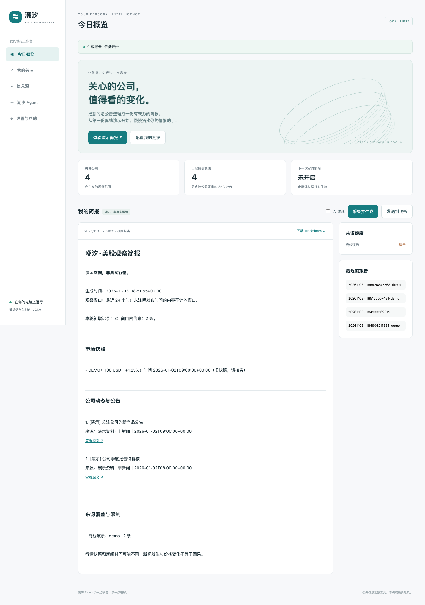

# 潮汐 Tide Community

**给你的第一位 Agent，一份真正有用的工作：关注美股公司，把公开新闻与公告整理成有来源的简报。**

本地网页 + Python 情报工具 + 可选 Hermes Agent。中文界面、无需前端构建、基础功能零第三方 Python 依赖。与作者私人使用的潮汐系统完全独立。



## 从这里开始

1. 安装 **Python 3.11 或更新版本**：[Python 官网](https://www.python.org/downloads/)。Hermes 安装器会单独准备 Python 3.14。
2. 下载 [最新发布包](https://github.com/Easton-Mei/tide-community/releases)，**解压到一个新文件夹**。
3. macOS 双击 `启动潮汐.command`；Windows 双击 `启动潮汐.bat`；Linux 执行 `bash start.sh`。
4. 浏览器打开 `http://127.0.0.1:8765`，点击 **体验演示简报**。演示无需联网和密钥。
5. 在「我的关注」添加公司，在首页点击 **采集并生成**。真实源需要网络。

如果 macOS 不允许直接启动，在终端进入文件夹执行 `bash 启动潮汐.command`。Windows 安装 Python 时勾选加入 PATH。首次启动可能需要允许浏览器打开本地地址。

> 下载源码就能运行基础版。发布包不含 Python、Hermes 本体或 API 额度；Hermes 是后续可选安装项。基础版并非一个完全离线的新闻服务，只有演示是离线的。

## 能做什么

- **公司关注**：内置 15 家常见公司的身份映射；其中部分附带官方 RSS。其他代码通过 SEC 公司目录验证，需填写 SEC 联系标识。
- **公开情报**：RSS/Atom、SEC 申报文件元数据、Yahoo 公共行情快照。
- **来源接入**：粘贴 RSS 或官网地址 → 发现订阅 → 预览 → 验证后保存。
- **报告**：规则报告无需模型；配置 OpenAI 兼容 API 后可用 AI 整理，原始底稿继续保留。
- **持续运行**：本地每日调度、历史去重、来源健康、可选飞书自定义机器人推送。
- **Agent**：Hermes 独立数据环境，通过相同 CLI 添加公司、查找订阅、接入来源、排查采集。

**边界明确：** 非实时行情保证；不自动交易；不接入券商；ETF 暂不按公司支持；任意网页自动生成采集器不在 v0.1 的交付范围。公司新闻源可能覆盖整家公司而非只限财务新闻。

## 开启 AI 与 Agent

**只需 AI 报告：** 在设置里填写服务商 Base URL、模型 ID、API Key，保存后勾选「AI 整理」。默认输入框是可修改的 DeepSeek 接口示例，不包含免费额度。

**需要 Agent 执行任务：** 运行 `安装 Hermes.command`，或 `python3 scripts/install_hermes.py`。安装器将锁定版本放到本项目 `.tools/`，不会修改其他 Hermes 配置。填写模型后开启「允许 Agent 使用终端与文件工具」，在 Agent 页提交任务。

Windows 的基础版可直接运行；Hermes 增强层请在 WSL 内使用同一项目。详细步骤见 [Agent 安装](docs/Agent安装.md)。

## 文件夹怎么理解

```text
Tide/
├── README.md              ← 先看这里
├── 启动潮汐.command/.bat  ← 双击启动
├── config/                ← 我的设置，首次启动自动生成
├── reports/               ← 我的报告，首次运行生成
├── data/                  ← 历史、密钥、Agent 数据，自动管理
├── logs/                  ← 预留运行日志目录
├── agent/                 ← 潮汐的工作说明和技能
├── app/                   ← 程序本体，日常不用改
├── docs/                  ← 中文教程与常见问题
├── examples/              ← 默认配置和明确标记的虚构示例
├── scripts/               ← 安装和打包工具
└── tests/                 ← 开发验证
```

**日常只需：用网页操作，到 reports 看报告。分享时使用原始发布包，不要直接压缩已经使用过的目录。**

## 教程

网页设置中可打开完整教程；也可离线双击 `docs/开始阅读.html`，不需要 Markdown 阅读器。

- [快速开始](docs/快速开始.md)：从下载到第一份真实报告。
- [常用操作](docs/常用操作.md)：添加公司、添加来源、定时运行和飞书推送。
- [Agent 安装](docs/Agent安装.md)：Hermes 独立安装、模型配置和任务执行。
- [视频教程脚本](docs/视频教程脚本.md)：适合录制“搭建第一个 Agent”。
- [常见问题](docs/常见问题.md)：安装、网络、来源、时区、模型与数据备份。
- [架构与开发](docs/架构与开发.md)：工具契约、数据流、验证与发布。
- [验证记录](docs/验证记录.md)：本版已测内容和未验证边界。

## 给进阶用户

```bash
python3 tide.py web
python3 tide.py report --demo
python3 tide.py add-symbol AAPL
python3 tide.py discover https://blogs.microsoft.com/feed/
python3 tide.py report
python3 -m unittest discover -s tests -v
```

用 `TIDE_HOME` 指定独立运行数据目录。网页默认只监听本机，不是公网服务；不建议通过端口转发或反向代理公开暴露。

定时任务只在程序运行、电脑醒着时执行。每天到指定时间执行一次，过点启动会补当天一次，失败需手动重试。休市日可能出现旧行情，报告会标记时间和过期状态。该定时器按日历日运行，并非交易日历。

## 开源与隐私

MIT License。欢迎提交问题与改进。请勿在 issue 中粘贴密钥、Webhook、完整个人数据库或 Agent 会话。

模型费用由所选服务商收取。潮汐不会把你的配置发送给作者；启用 AI 时材料发给你配置的模型服务商，启用推送时报告发到你配置的飞书机器人。终端 Agent 使用你的系统用户权限，独立数据目录不等于安全沙箱。

新闻、市场数据及 Hermes 等第三方组件的使用边界见 [第三方说明](THIRD_PARTY_NOTICES.md)。
